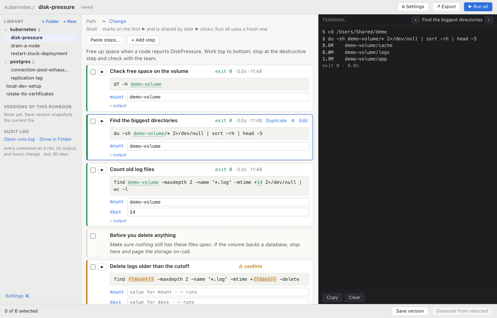

# Runbook

A small macOS desktop app for ops runbooks: write them as ordered shell steps, run them one
at a time or top to bottom, keep what happened, and share them as plain Markdown.

It was built to replace the usual pattern of keeping a runbook in a doc and copy-pasting
commands into a terminal one by one — losing, every time, the record of what was actually run
and what it printed.

<picture>
  <source media="(prefers-color-scheme: dark)" srcset="docs/screenshot-dark.png">
  
</picture>

## What it does

- **Steps, not scripts.** A runbook is a list of named steps. Each is either a shell command
  or a note. Run one with ▶, or run the whole runbook from the top.
- **A real shell.** Single ▶ clicks share one persistent `bash` session, so `cd`, `export` and
  shell functions carry over between steps the way they do in a terminal. **Run all** starts a
  fresh one. The session picks up your login environment, so a GUI-launched app still finds
  the tools on your `PATH`.
- **Stops on failure.** A run halts at the first failing step unless that step is marked
  *continue on failure*. Steps can also be marked *destructive* (confirm before running),
  *skip in Run all*, or given a timeout.
- **Blanks.** A command can contain `{{disk}}`-style placeholders, filled in per run and
  remembered per step, so one step can be re-run against different values. Values are shell-quoted.
- **It remembers.** Output is kept per step, and every run is appended to an audit log.
- **Markdown in, Markdown out.** Paste a doc, a numbered list or a terminal session and it
  becomes steps. Export back to Markdown, with or without output.
- **Notion import** (optional, read-only) — paste a page link and turn its headings and code
  blocks into steps.

## Install

No notarised release yet. Build it yourself, or unzip a build someone sent you.

The app is signed ad-hoc, not with an Apple Developer ID. A build you downloaded will be
quarantined by Gatekeeper and open with *"runbook.app is damaged and can't be opened"* — which
means unsigned, not broken. Clear it once:

```bash
xattr -dr com.apple.quarantine /Applications/runbook.app
```

### Build from source

Needs Go 1.23+, Node 22+ (Vite 8) and the [Wails v2](https://wails.io) CLI (`go install
github.com/wailsapp/wails/v2/cmd/wails@latest`).

```bash
cd app && wails build
```

The bundle lands in `app/build/bin/runbook.app`.

## Writing a runbook

A runbook is one Markdown file. Build it step by step in the app, write it by hand, or have an
AI write it and paste the result in.

### The format

````markdown
---
name: disk-pressure
cwd: ~
---

Free up space when a volume fills up. Work top to bottom; stop at the destructive step and
check with the team.

## 1. Check free space on the volume

```sh
df -h {{mount}}
```

## 2. Find the biggest directories

```sh
du -sh {{mount}}/* 2>/dev/null | sort -rh | head -5
```

## 3. Before you delete anything

> Make sure nothing still has these files open. If the volume backs a database, stop here
> and page the storage on-call.

## 4. Delete logs older than the cutoff

```yaml meta
destructive: true
```

```sh
find {{mount}} -maxdepth 2 -name '*.log' -mtime +{{days}} -delete
```
````

- **Front matter** names the runbook and sets `cwd`, the directory its commands start in (`~`
  if you leave it out). The app adds more settings here when you change them in Settings.
- **Text before the first step** is the runbook's description.
- **`## N. Title`** starts a step. The numbers are corrected on save, so don't worry about them.
- **A command step** is the first code block under the heading, tagged `sh`, `bash`, `shell`,
  `zsh`, `console` or left untagged. The whole block runs as one step, in `bash`.
- **A note step** is a blockquote with no code block: a manual check, a warning, who to call.
- **`{{name}}` is a blank**, filled in when you run the step (letters, digits, `-` and `_`).
  The value is shell-quoted for you, so write `{{mount}}`, not `"{{mount}}"`.
- **Step settings** go in a `yaml meta` block between the heading and the command.
- Anything else under a step, such as a paragraph or a block of sample output, is kept in the
  file but never run.

| Step setting           | What it does                                                        |
| ---------------------- | ------------------------------------------------------------------- |
| `destructive: true`    | Asks for confirmation before the step runs                          |
| `continueOnFail: true` | Carries on with the run if this step fails                          |
| `skipInRunAll: true`   | Leaves the step out of **Run all**; it runs only when you click ▶   |
| `timeoutSec: 300`      | Stops the step after that many seconds; `null` for no limit (default 60) |
| `cwd: /some/path`      | Runs this step from a different directory                           |
| `recordOutput: false`  | Doesn't keep the step's output, for commands that print secrets     |

### Getting it into the app

- **A whole runbook:** click **+ New** and name it, then **Edit steps…**, paste over the text
  and choose **Replace runbook** (⌘⏎). Text that doesn't parse is refused with the reason, and
  nothing changes. The runbook keeps the name you gave it, whatever `name` the pasted text has.
- **More steps for a runbook you have open:** **Paste steps…** is more forgiving. It also takes
  numbered lists and copied terminal sessions, and shows what it found before adding anything.
- **As a file:** save it as `~/runbooks/<name>/runbook.md` and click ↻ in the Library.

### Asking an AI to write one

Fill in the second paragraph and give this to your assistant. Paste what comes back into
**Edit steps…**.

`````text
Write a runbook for the Runbook app, which runs Markdown runbooks as ordered shell steps.
Reply with only the runbook, in one code block fenced with four backticks so that the
three-backtick fences inside it survive.

What the runbook is for:
<describe the task, the system it runs against, and anything that must not be touched>

Format:
- Start with front matter holding `name` (lowercase letters, digits and hyphens) and `cwd`
  (the directory commands start in; use ~ if unsure).
- After the front matter, one or two sentences on when to use the runbook.
- Each step is a heading "## N. Title" followed by exactly one ```sh block.
- A step with a blockquote ("> text") and no code block is a note. Use notes for manual
  checks, warnings and who to escalate to.
- For a value I have to supply when I run it, write a blank like {{namespace}} (letters,
  digits, - and _). The app shell-quotes the value, so never put quotes around a blank and
  never use placeholders like <namespace>.
- For any step that changes or deletes something, put this block between the heading and
  the command:
  ```yaml meta
  destructive: true
  ```
  The same block can also hold continueOnFail: true (carry on if the step fails),
  skipInRunAll: true (only run when clicked), timeoutSec: <seconds, or null for no limit>
  and recordOutput: false (for steps that print secrets).

How steps run:
- In order, in one /bin/bash session (bash 3.2 on macOS), so cd, export and shell functions
  carry over to later steps. Don't use bash 4+ features.
- A run stops at the first step that exits non-zero, unless that step has
  continueOnFail: true.
- There is no terminal attached: no editors, pagers, prompts or watch. Every command must
  finish by itself.
- A step is stopped after 60 seconds unless it sets timeoutSec.

Good practice:
- One action per step, with a title that says what it does.
- Read-only checks first, then changes, then a step that verifies each change.
- No secrets in commands; read them from the environment.

Example:

---
name: restart-stuck-deployment
cwd: ~
---

Use when a deployment's pods are stuck and a restart is the agreed fix.

## 1. Show pods that aren't running

```sh
kubectl get pods -n {{namespace}} | grep -v Running
```

## 2. Confirm before restarting

> Check the last deploy time with the owning team. Don't restart during a rollout.

## 3. Restart the deployment

```yaml meta
destructive: true
timeoutSec: 300
```

```sh
kubectl rollout restart deploy/{{deployment}} -n {{namespace}}
kubectl rollout status deploy/{{deployment}} -n {{namespace}}
```
`````

An AI-written runbook is still commands that run as you, so read it before you run it.

## Where your data lives

Everything is files under `~/runbooks`, one directory per runbook:

```
~/runbooks/<name>/runbook.md            the runbook — the source of truth
~/runbooks/<name>/runs.log              audit log (JSONL), last 30 days
~/runbooks/<name>/versions/vN.md        snapshots you chose to save
~/runbooks/<name>/.runbook/state.json   step ids and last output per step
```

`runbook.md` is ordinary Markdown and round-trips byte-for-byte, so the library is yours: edit
it in another editor, keep it in git, back it up, or walk away from this app entirely. A
generated `.gitignore` keeps `runs.log` and the output cache out of any git repo you make.
Deleting a runbook moves its directory to the Trash.

## Please read this part

**The app runs shell commands as you.** That is the whole point of it, but it means a runbook
is executable code with your credentials, and a runbook someone sends you deserves the same
reading as a script someone sends you. There is no sandbox and no privilege boundary.

**The audit log records commands and their output.** If a command prints a secret, that secret
reaches `runs.log` and the output cache. Secrets are masked on a **best-effort** basis: values
from your environment, recognisable token shapes (AWS, GitHub, Slack, JWTs, PEM blocks),
`NAME=value` assignments with sensitive-looking names, and Kubernetes Secret payloads. It is a
set of patterns, not a guarantee — assume something will eventually slip through. Steps that
print things you'd rather not keep can be switched to **don't record output**, and the audit
log can be turned off per runbook.

**Everything stays local.** The app makes no network calls of its own. The one exception is
Notion import, and only while you use it: it reads the page you link to and writes nothing
back. The integration token is kept in your login Keychain rather than in a config file, so it
can't end up in a runbook, an export or a backup of `~/runbooks` — but anything running as your
user can still read it, exactly as with any file in your home directory.

## Built with Claude

This app was written with [Claude Code](https://claude.com/claude-code), from a spec and
wireframes in [`spec/`](spec/). It isn't AI-assisted autocomplete over a human-written
codebase — the implementation is Claude's, reviewed, tested and directed by a human, over a
series of sessions.

[`spec/DECISIONS.md`](spec/DECISIONS.md) is the running record of every decision that
isn't in the original spec, and why. It is the best place to start if you want to know how
something behaves or why it works the way it does.

The risky parts — shell session handling, Markdown round-tripping, secret redaction, the
audit log — are plain Go packages with no Wails dependency and their own tests (`cd app && go
test ./...`).

## Licence

Apache-2.0. See [LICENSE](LICENSE).
